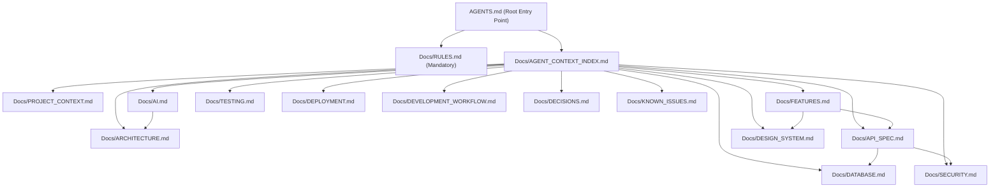

# FitTrack AI - Agent Context Index & Dependency Map

## 1. Documentation Dependency Graph

---

## 2. Granular Document Map & Context Router

### A. Core & Governance Documents

#### `Docs/RULES.md`
- **What It Contains**: Mandatory engineering constraints, coding conventions, naming rules, contrast invariants, and security mandates.
- **When to Read**: **ALWAYS**. No task is exempt.
- **Related Source Directories**: Repository-wide (`backend/`, `frontend/`, `worker/`).
- **Dependent Documents**: All documents in `Docs/`.
- **Update When**: New repository-wide coding conventions, invariants, or architectural constraints are adopted.

#### `Docs/PROJECT_CONTEXT.md`
- **What It Contains**: High-level mission, personas, canonical measurement standards (cm / kg), domain invariants.
- **When to Read**: When starting work on new features, user journeys, or reviewing overarching business logic.
- **Related Source Directories**: `frontend/src/`, `backend/src/modules/`.
- **Dependent Documents**: `Docs/ARCHITECTURE.md`, `Docs/FEATURES.md`.
- **Update When**: Domain invariants or target audience scope change.

---

### B. Architecture & Infrastructure Documents

#### `Docs/ARCHITECTURE.md`
- **What It Contains**: System topology, monorepo directory layout, Fastify app factory, Fastify plugin system, React layout architecture, MediaPipe CV edge pipeline.
- **When to Read**: Refactoring system layers, adding new backend modules, or altering cross-cutting infrastructure.
- **Related Source Directories**: `backend/src/app.ts`, `backend/src/plugins/`, `frontend/src/components/`, `frontend/src/context/`.
- **Dependent Documents**: `Docs/API_SPEC.md`, `Docs/AI.md`, `Docs/SECURITY.md`.
- **Update When**: New services, top-level modules, or fundamental architecture patterns are modified.

#### `Docs/DATABASE.md`
- **What It Contains**: PostgreSQL 16 schema, Prisma models, entity relationships, indexing, migration workflows.
- **When to Read**: Database schema changes, writing complex Prisma queries, or data modeling.
- **Related Source Directories**: `backend/prisma/schema.prisma`, `backend/prisma/migrations/`, `backend/prisma/seed.ts`.
- **Dependent Documents**: `Docs/API_SPEC.md`, `Docs/ARCHITECTURE.md`.
- **Update When**: Prisma schema is modified, new tables/fields/indexes are added.

#### `Docs/DEPLOYMENT.md`
- **What It Contains**: Docker Compose configuration, environment variables checklist, container commands, HTTPS requirements, production health probes.
- **When to Read**: Docker configurations, server deployments, environment variable changes, CI/CD pipeline work.
- **Related Source Directories**: `docker-compose.yml`, `backend/src/config/`, `.env.example`.
- **Dependent Documents**: `Docs/ARCHITECTURE.md`.
- **Update When**: Container setup, port allocations, or required environment variables change.

---

### C. Application Logic & User Experience Documents

#### `Docs/FEATURES.md`
- **What It Contains**: Detailed catalog of all 10 platform feature domains, specifications, and mathematical formulas (Epley 1RM, Overload heuristics).
- **When to Read**: Implementing or modifying user-facing functionality.
- **Related Source Directories**: `frontend/src/features/`, `frontend/src/pages/`, `backend/src/modules/`.
- **Dependent Documents**: `Docs/API_SPEC.md`, `Docs/DESIGN_SYSTEM.md`.
- **Update When**: Features are added, modified, or formula behaviors are refined.

#### `Docs/API_SPEC.md`
- **What It Contains**: Complete REST API specifications for `/api/v1/*`, HTTP methods, request/response schemas, status codes.
- **When to Read**: Modifying or creating API endpoints, integrating frontend APIs with backend routes.
- **Related Source Directories**: `backend/src/modules/**/` (`*.routes.ts`, `*.controller.ts`, `*.schemas.ts`), `frontend/src/features/**/*Api.ts`.
- **Dependent Documents**: `Docs/FEATURES.md`, `Docs/SECURITY.md`.
- **Update When**: Any endpoint is added, updated, or request/response payloads change.

#### `Docs/DESIGN_SYSTEM.md`
- **What It Contains**: Theme system (Dark/Light), Emerald/Teal color palette, high-contrast invariants, typography, responsive layouts.
- **When to Read**: Building or styling UI components, adjusting colors, or resolving light mode contrast issues.
- **Related Source Directories**: `frontend/src/index.css`, `frontend/src/components/`, `frontend/src/features/`.
- **Dependent Documents**: `Docs/FEATURES.md`.
- **Update When**: New UI design tokens, global component patterns, or contrast rules are introduced.

---

### D. Advanced Systems & Operations Documents

#### `Docs/SECURITY.md`
- **What It Contains**: Authentication flow (Argon2, dual-token JWT rotation), Google GIS verification, Helmet/CORS headers, rate limiting, tenant isolation.
- **When to Read**: Modifying authentication, authorization, user permissions, or handling sensitive biometrics.
- **Related Source Directories**: `backend/src/modules/auth/`, `backend/src/plugins/`, `frontend/src/context/AuthContext.tsx`.
- **Dependent Documents**: `Docs/API_SPEC.md`, `Docs/ARCHITECTURE.md`.
- **Update When**: Auth protocols, encryption methods, or rate limit policies change.

#### `Docs/AI.md`
- **What It Contains**: Google Gemini API prompt engineering, model cascades, rate limits, MediaPipe Pose CV kinematics, joint angle math, and state machines.
- **When to Read**: Working on AI Copilot, prompt templates, MediaPipe Pose tracking, or exercise rep detection.
- **Related Source Directories**: `backend/src/modules/copilot/`, `frontend/src/features/copilot/`, `frontend/src/features/formAnalysis/`, `frontend/src/pages/AiFormPage.tsx`.
- **Dependent Documents**: `Docs/ARCHITECTURE.md`, `Docs/FEATURES.md`.
- **Update When**: Prompt templates, LLM models, CV landmark mappings, or exercise state machines are modified.

#### `Docs/TESTING.md`
- **What It Contains**: Test runner commands, Fastify `app.inject()` patterns, static typechecks, simulated pose test harnesses, pre-commit checklist.
- **When to Read**: Writing new unit tests, debugging test failures, or validating code before committing.
- **Related Source Directories**: `backend/src/modules/**/__tests__/`, `frontend/src/features/formAnalysis/simulatedPose.ts`.
- **Dependent Documents**: `Docs/RULES.md`.
- **Update When**: Testing configurations, test runners, or validation requirements change.

#### `Docs/DEVELOPMENT_WORKFLOW.md`
- **What It Contains**: Local quickstart, step-by-step feature protocol, Conventional Commit conventions, i18n key parity protocol.
- **When to Read**: Setting up local dev environment, planning commits, or adding bilingual keys.
- **Related Source Directories**: `package.json`, `frontend/src/i18n/locales/`.
- **Dependent Documents**: `Docs/RULES.md`.
- **Update When**: Development scripts, commit scopes, or workflow steps evolve.

#### `Docs/DECISIONS.md`
- **What It Contains**: Architectural Decision Records (ADRs) detailing why specific technical trade-offs were accepted.
- **When to Read**: Evaluating architectural refactors or understanding the rationale behind existing patterns.
- **Related Source Directories**: Repository-wide.
- **Dependent Documents**: `Docs/ARCHITECTURE.md`.
- **Update When**: Any significant architectural decision is made or amended.

#### `Docs/KNOWN_ISSUES.md`
- **What It Contains**: Active limitations, air-gapped database connection behavior, camera permissions, and planned mitigations.
- **When to Read**: Investigating unexpected timeouts, offline behavior, or environment discrepancies.
- **Related Source Directories**: `backend/src/infrastructure/database/`, `frontend/src/features/formAnalysis/`.
- **Dependent Documents**: `Docs/DEVELOPMENT_WORKFLOW.md`.
- **Update When**: Known issues are resolved or new runtime limitations are discovered.

---

## 3. Documentation Update Matrix

| If You Changed: | You Must Update: |
|---|---|
| UI styling, tokens, or layouts | `Docs/DESIGN_SYSTEM.md`, `Docs/FEATURES.md` |
| REST endpoints, schemas, or status codes | `Docs/API_SPEC.md`, `Docs/FEATURES.md` |
| Prisma models, migrations, or indexes | `Docs/DATABASE.md`, `Docs/API_SPEC.md` |
| Authentication, JWT, or Google GIS | `Docs/SECURITY.md`, `Docs/API_SPEC.md` |
| Gemini prompts or MediaPipe CV state machines | `Docs/AI.md`, `Docs/FEATURES.md` |
| Architecture patterns or service topology | `Docs/ARCHITECTURE.md`, `Docs/DECISIONS.md` |
| Dependencies or environment variables | `Docs/DEPLOYMENT.md`, `Docs/DEVELOPMENT_WORKFLOW.md` |
| Test harnesses or verification rules | `Docs/TESTING.md`, `Docs/RULES.md` |

---

## Changelog

| Version | Date | Changes |
|---|---|---|
| 1.0.0 | 2026-09-16 | Initial baseline of comprehensive agent context index and dependency map |
