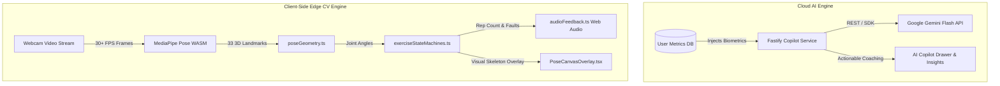
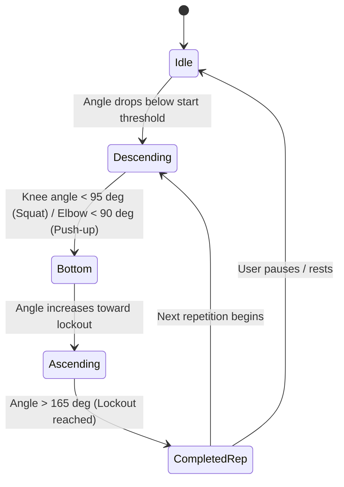

# FitTrack AI - AI & Computer Vision Architecture

## 1. Dual-Engine Intelligence Architecture

FitTrack AI combines cloud-based LLM reasoning with edge-based computer vision:



---

## 2. Cloud LLM: Google Gemini Copilot

### A. Model Strategy & Cascade
Located in `backend/src/modules/copilot/copilot.service.ts`.
- Primary Model: `gemini-flash-lite-latest` / `gemini-3.5-flash-lite`.
- Resilient Fallback Cascade: If a model quota or region error occurs, the service automatically attempts:
  1. `gemini-flash-lite-latest`
  2. `gemini-3.5-flash-lite`
  3. `gemini-3.5-flash`
  4. Deterministic Local Rule Engine (offline graceful degradation)

### B. System Prompt Context Injection
The Gemini system prompt dynamically embeds verified user context:
```text
You are FitTrack AI Coach, an elite certified strength & conditioning coach and sports nutritionist.
Current User Profile & Biometrics:
- Biological Sex: {biologicalSex}
- Age: {age} years old
- Height: {height} cm
- Current Weight: {currentWeight} kg
- Target Weight: {targetWeight} kg
- BMI: {bmi} kg/m²
- Activity Level: {activityLevel}
- Primary Fitness Goal: {fitnessGoal}
- This Week's Training: {weeklyVolumeKg} kg total volume across {recentSessionCount} completed sessions.
```

### C. Deterministic Progressive Overload Engine
While Gemini handles qualitative questions, load progressions are calculated deterministically to prevent hallucinated unsafe weights:
- Exercises `< 60 kg`: `+2.5 kg` increment
- Exercises `≥ 60 kg`: `+5.0 kg` increment
- Deload Trigger: Triggered when recovery score $< 72\%$, advising a `40%` working volume reduction.

### D. Multi-Turn Conversational Memory & Gemini-Style Chat Threads
- **Multi-Turn Context Ingestion**: The backend `/api/v1/gemini/chat` accepts an optional `history` array of prior `{ role: 'user' | 'assistant', text: string }` turns. The service converts these turns into Gemini's native `contents` array (`user` and `model` roles), ensuring follow-up queries retain full conversational context.
- **Client-Side Thread Isolation**: Threads are organized similarly to Google Gemini with a collapsible thread management sidebar, individual thread history, copy actions, and per-user local storage persistence (`fittrack_gemini_threads_${userId}`).

---

## 3. Client-Side Edge CV: MediaPipe Pose

### A. Kinematic Geometry Calculation
Joint angles are calculated in `frontend/src/features/formAnalysis/poseGeometry.ts` using the dot product formula:
$$\theta = \arccos\left(\frac{\mathbf{u} \cdot \mathbf{v}}{\|\mathbf{u}\| \|\mathbf{v}\|}\right) \times \frac{180^\circ}{\pi}$$

Example landmarks:
- **Knee Angle**: Angle between Hip ($L_{23}/L_{24}$), Knee ($L_{25}/L_{26}$), and Ankle ($L_{27}/L_{28}$).
- **Elbow Angle**: Angle between Shoulder ($L_{11}/L_{12}$), Elbow ($L_{13}/L_{14}$), and Wrist ($L_{15}/L_{16}$).
- **Hip Hinge Angle**: Angle between Shoulder, Hip, and Knee.

### B. Finite State Machine Rep Counter
Located in `frontend/src/features/formAnalysis/exerciseStateMachines.ts`:



### C. Fault Detection Heuristics
- **Squat Insufficient Depth**: Flagged if ascending begins before knee angle reaches $\le 100^\circ$.
- **Knee Valgus (Cave)**: Monitored via distance ratio between knees vs ankles.
- **Push-up Sagging Hips**: Torso-to-thigh angle deviates by $> 15^\circ$ from neutral $180^\circ$.

### D. Audio Feedback Engine
Located in `frontend/src/features/formAnalysis/audioFeedback.ts`:
- Web Audio API synthesizes affirmative chime frequencies (`587 Hz → 880 Hz`) upon successful rep completion.
- SpeechSynthesis API provides immediate vocal coaching prompts (e.g., *"Hạ sâu hơn nữa"*, *"Thẳng lưng"*).

---

## Changelog

| Version | Date | Changes |
|---|---|---|
| 1.1.0 | 2026-09-16 | Added multi-turn conversational context retention and Gemini-style thread management |
| 1.0.0 | 2026-09-16 | Initial baseline of dual-engine AI architecture, Gemini prompts, and MediaPipe CV kinematics |
