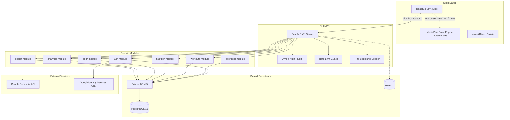

# FitTrack AI - System Architecture

## 1. System Topology

FitTrack AI is structured as a high-performance, modular monorepo:



---

## 2. Monorepo Directory Organization

```text
FitTrackAI/
├── AGENTS.md                  # Central agent routing and engineering guide
├── Docs/                      # Canonical technical documentation
├── backend/                   # Fastify 5 REST API
│   ├── prisma/                # Schema, migrations, seed script
│   └── src/
│       ├── config/            # Environment variable validation via Zod
│       ├── infrastructure/    # Database (Prisma) and Redis clients
│       ├── modules/           # Domain-driven vertical slices
│       │   ├── analytics/     # 1RM trajectory, muscle distribution, PRs
│       │   ├── auth/          # Argon2, Google GIS, JWT, token refresh
│       │   ├── body/          # Weight history, moving avg, measurements
│       │   ├── copilot/       # Gemini chat, overload recommendations
│       │   ├── exercises/     # Seeded & custom exercises library
│       │   ├── health/        # Liveness & readiness probes
│       │   ├── nutrition/     # Meal logs, USDA food search, daily targets
│       │   └── workouts/      # Plans, active sessions, set logger
│       ├── plugins/           # Fastify plugins (JWT, auth decorator, CORS)
│       ├── shared/            # Common error schemas, logger, helpers
│       ├── app.ts             # Fastify application factory
│       └── server.ts          # Server entry point
├── frontend/                  # React 18 SPA (Vite)
│   └── src/
│       ├── components/        # Global layout, navigation, ThemeToggle
│       ├── context/           # AuthContext, ThemeContext
│       ├── features/          # Feature-level components, types, APIs
│       │   ├── analytics/     # Volume pie charts, 1RM progression charts
│       │   ├── auth/          # Login/Register modals, Google OAuth
│       │   ├── body/          # Weight trend line, measurement modals
│       │   ├── copilot/       # AiCopilotDrawer, OverloadAdvisorCard
│       │   ├── cv/            # MediaPipe Pose canvas, camera overlay
│       │   ├── exercises/     # Exercise cards, filter toolbar, detail modal
│       │   ├── formAnalysis/  # Exercise state machines, audio feedback
│       │   ├── nutrition/     # Meal logs, calorie meters, food modal
│       │   └── workouts/      # ActiveSession, plan creator, rest timer
│       ├── i18n/              # Locales (en.json, vi.json) & config
│       ├── pages/             # Route-level pages
│       ├── index.css          # Design system tokens & Tailwind overrides
│       ├── App.tsx            # Route configuration
│       └── main.tsx           # React DOM root mounting
├── worker/                    # Background task worker (TypeScript)
│   └── src/index.ts           # Worker entry
├── docker-compose.yml         # Local development Postgres 16 & Redis 7
└── package.json               # Root monorepo scripts
```

---

## 3. Backend Architectural Patterns

### A. Modular Vertical Slice Structure
Each backend module under `backend/src/modules/` is self-contained and exposes:
- `*.routes.ts`: Fastify route registrations with route-level hooks (`preHandler`).
- `*.controller.ts`: Request parsing, parameter extraction, and reply formatting.
- `*.service.ts`: Business logic, domain calculations, database queries.
- `*.schemas.ts`: Zod validation schemas for input/output payloads.
- `__tests__/*.test.ts`: Module-specific unit and integration tests.

### B. Fastify App Factory Pattern
The Fastify application instance is instantiated via `buildApp()` in `backend/src/app.ts`. This permits rapid, isolated testing via `app.inject()` without binding to actual network TCP sockets.

### C. Authentication Flow
- Token Strategy: Dual token mechanism with short-lived JWT Access Tokens (15 minutes) and rotating DB Refresh Tokens (30 days).
- In-memory Decorator: Fastify request context is decorated with `fastify.authenticate` (enforces valid JWT) and `fastify.optionalAuthenticate` (attaches user if present, permits guest requests).

---

## 4. Frontend Architectural Patterns

### A. Navigation & Layout
- Desktop: Collapsible sidebar navigation rail (`w-20` mini rail, expandable to `w-64` with interactive burger button) with dynamic breadcrumb header.
- Mobile: Bottom navigation bar for high-frequency workflows (Dashboard, Workouts, AI Form, Nutrition, Profile).

### B. State Management
- Authentication: `AuthContext` provides login state, JWT storage in `localStorage`, and silent refresh interceptor.
- Theme: `ThemeContext` persists user preference (`dark`, `light`, `system`) and updates the document root class.
- Offline Resilience: Workout sessions, customized plans, and weight logs feature local fallback storage (`fittrack_*` localStorage keys) ensuring offline usability when the network is severed.

---

## 5. Computer Vision Form Analysis Engine

To deliver instantaneous zero-latency coaching without costly cloud GPU streaming:
1. Video Capture: HTML5 `<video>` stream from user's webcam.
2. Inference: Google MediaPipe Pose runs entirely client-side via WebAssembly/WebGL, outputting 33 3D body landmarks at 30+ FPS.
3. Kinematics: `poseGeometry.ts` calculates joint angles (knee flexion, hip hinge, elbow flexion, torso angle).
4. State Machine: `exerciseStateMachines.ts` enforces discrete states (`idle` → `descending` → `bottom` → `ascending` → `completed_rep`), detecting rep completion and form deviations (e.g., knee cave, insufficient depth).
5. Audio Feedback: `audioFeedback.ts` triggers Web Audio API tones and synthesized voice prompts.

---

## Changelog

| Version | Date | Changes |
|---|---|---|
| 1.0.0 | 2026-09-16 | Initial baseline of end-to-end system architecture, topology, and module structure |
