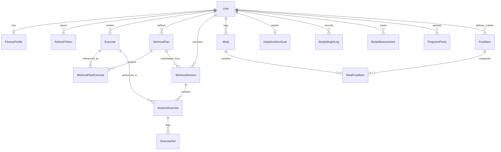

# FitTrack AI - Database Architecture & Schema

## 1. Database Architecture & Technology
- **Database Engine**: PostgreSQL 16 (Compatible with AWS RDS, Neon Serverless, Supabase, and local Docker).
- **ORM & Migrations**: Prisma ORM 5.22.0 (`@prisma/client`).
- **Connection Management & Driver Adapters**:
  - Direct connection for migrations (`schema.prisma` / `prisma migrate`).
  - `@prisma/adapter-neon` and `@neondatabase/serverless` over WebSockets (`ws`) on port 443 for serverless Neon database environments, bypassing ISP / firewall port 5432 TCP resets.
  - Native connection pool lifecycle managed via `src/infrastructure/database/prisma.ts`.
- **Identifier Strategy**: Universal UUIDv4 strings for all primary keys (`@default(uuid())`).

---

## 2. Entity Relationship Diagram (ERD)



---

## 3. Schema Data Dictionary

### A. Users & Authentication

#### `users`
- `id` (UUID, PK): Unique identifier.
- `email` (VARCHAR, Unique): Case-insensitive user email.
- `password_hash` (TEXT): Argon2 salted password hash.
- `display_name` (VARCHAR): User's profile display name.
- `avatar_url` (TEXT, Nullable): S3/Cloudinary or Google profile picture.
- `created_at` / `updated_at` (TIMESTAMP): Auditing timestamps.

#### `fitness_profiles`
- `id` (UUID, PK): Unique identifier.
- `user_id` (UUID, Unique, FK): One-to-one mapping to `users.id` (CASCADE delete).
- `height` (FLOAT, Nullable): Height in canonical centimeters (`cm`).
- `current_weight` (FLOAT, Nullable): Baseline weight in kilograms (`kg`).
- `target_weight` (FLOAT, Nullable): Goal weight in kilograms (`kg`).
- `date_of_birth` (TIMESTAMP, Nullable): User birthday for age calculation.
- `biological_sex` (VARCHAR, Nullable): `"male"` | `"female"` | `"other"`.
- `activity_level` (VARCHAR, Nullable): `"sedentary"`, `"lightly_active"`, `"moderately_active"`, `"very_active"`.
- `fitness_goal` (VARCHAR, Nullable): `"muscle_gain"`, `"fat_loss"`, `"strength"`, `"endurance"`.

#### `refresh_tokens`
- `id` (UUID, PK): Unique identifier.
- `user_id` (UUID, FK): Mapping to `users.id` (CASCADE delete).
- `token_hash` (TEXT, Unique): Argon2/SHA-256 hash of issued refresh token.
- `expires_at` (TIMESTAMP): Expiration date (30 days from issuance).
- `is_revoked` (BOOLEAN): Soft revocation flag for token rotation.

---

### B. Exercise & Workout Management

#### `exercises`
- `id` (UUID, PK): Unique identifier.
- `name` (VARCHAR): Exercise name (e.g., "Barbell Bench Press").
- `slug` (VARCHAR, Unique): URL-safe slug.
- `category` (VARCHAR): `"strength"` | `"stretching"` | `"cardio"` | `"plyometrics"`.
- `force` (VARCHAR, Nullable): `"push"` | `"pull"` | `"static"`.
- `level` (VARCHAR): `"beginner"` | `"intermediate"` | `"expert"`.
- `mechanic` (VARCHAR, Nullable): `"compound"` | `"isolation"`.
- `equipment` (VARCHAR, Nullable): `"body only"` | `"barbell"` | `"dumbbell"` | `"machine"` | `"cable"`.
- `primary_muscles` (TEXT[]): List of primary target muscles.
- `secondary_muscles` (TEXT[]): List of secondary stabilizer muscles.
- `instructions` (TEXT[]): Step-by-step performance cues.
- `image_urls` (TEXT[]): Media assets illustrating form.
- `is_custom` (BOOLEAN): `false` for global seeded exercises, `true` for user-created.
- `user_id` (UUID, Nullable, FK): Owner of custom exercise (`null` if global).

#### `workout_plans`
- `id` (UUID, PK): Unique identifier.
- `user_id` (UUID, FK): Tenant owner.
- `name` (VARCHAR): Plan title (e.g., "Upper Body Hypertrophy").
- `description` (TEXT, Nullable): Routine notes.
- `target_muscles` (TEXT[]): Aggregated target muscle groups.

#### `workout_sessions`
- `id` (UUID, PK): Unique identifier.
- `user_id` (UUID, FK): Tenant owner.
- `plan_id` (UUID, Nullable, FK): Instantiating workout plan.
- `name` (VARCHAR): Session name.
- `status` (VARCHAR): `"in_progress"` | `"completed"` | `"abandoned"`.
- `started_at` (TIMESTAMP): Session start time.
- `completed_at` (TIMESTAMP, Nullable): Session end time.
- `duration_seconds` (INT, Default 0): Total elapsed working time.
- `total_volume_kg` (FLOAT, Default 0): Total accumulated tonnage ($\sum \text{weight} \times \text{reps}$).

#### `exercise_sets`
- `id` (UUID, PK): Unique identifier.
- `session_exercise_id` (UUID, FK): Parent exercise inside session.
- `set_number` (INT): Order of set.
- `weight_kg` (FLOAT): Working load in kilograms.
- `reps` (INT): Number of completed repetitions.
- `rpe` (FLOAT, Nullable): Rate of Perceived Exertion (1.0 to 10.0).
- `is_completed` (BOOLEAN, Default false): Completion status.

---

### C. Nutrition Tracking

#### `meals` & `meal_food_items`
- Meals group food items into `Breakfast`, `Lunch`, `Dinner`, or `Snack`.
- `MealFoodItem` records maintain **immutable snapshot columns**:
  - `serving_size` (FLOAT)
  - `serving_unit` (VARCHAR)
  - `calories` (FLOAT)
  - `protein_g` (FLOAT)
  - `carbs_g` (FLOAT)
  - `fat_g` (FLOAT)

---

### D. Body Composition & Progress

#### `body_weight_logs`
- `id` (UUID, PK)
- `user_id` (UUID, FK, Indexed)
- `weight_kg` (FLOAT): Recorded weight.
- `logged_at` (TIMESTAMP): Date of weigh-in.

#### `body_measurements`
- Stores circumferences strictly in centimeters (`cm`):
  - `neck_cm`, `shoulders_cm`, `chest_cm`, `left_bicep_cm`, `right_bicep_cm`, `waist_cm`, `hips_cm`, `left_thigh_cm`, `right_thigh_cm`, `left_calf_cm`, `right_calf_cm`.

---

## 4. Migrations & Database Operations

```bash
# Generate Prisma Client
npm run prisma:generate

# Run development migrations
npm run prisma:migrate

# Seed database with standard exercises and food library
npm --prefix backend run prisma:seed

# Start local PostgreSQL & Redis via Docker
npm run db:up
```

---

## Changelog
 
| Version | Date | Changes |
|---|---|---|
| 1.1.0 | 2026-09-16 | Added `@prisma/adapter-neon` serverless driver adapter with WebSocket support for resilient Neon connectivity |
| 1.0.0 | 2026-09-16 | Initial baseline database schema documentation and ER diagram |
