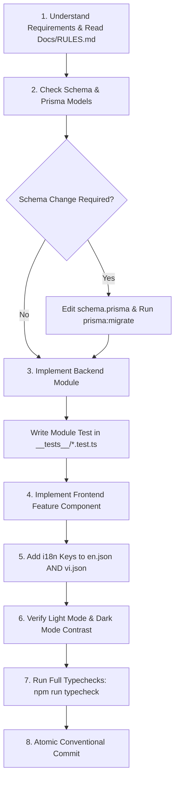

# FitTrack AI - Developer & Agent Workflow

## 1. Local Development Quickstart

```bash
# 1. Start database containers
npm run db:up

# 2. Run backend in development mode (hot-reloading via tsx watch)
npm run dev:backend

# 3. In a separate terminal, run frontend (Vite dev server on http://localhost:5173)
npm run dev:frontend
```

Vite proxies `/api/v1` requests directly to the Fastify backend on port `5000`, eliminating CORS hurdles during local iteration.

---

## 2. Step-by-Step Feature Implementation Flow

Every new feature or substantial code modification must follow this rigorous engineering sequence:



---

## 3. Git Commit Conventions & Atomic Commits

Commits must follow Conventional Commits format:
- `feat(<domain>): <concise description>`
- `fix(<domain>): <concise description>`
- `refactor(<domain>): <concise description>`
- `style(<domain>): <concise description>`
- `docs(<domain>): <concise description>`
- `test(<domain>): <concise description>`

### Commit Scopes
- `auth`: Authentication, Google GIS, JWT, tokens.
- `workouts`: Plans, active session, set logger, rest timer.
- `exercises`: Exercise library, search, filters, categories.
- `analytics`: 1RM progression, volume distribution, PRs.
- `copilot`: Gemini AI chat, progressive overload advisor, deload alerts.
- `form`: MediaPipe Pose CV, state machines, audio feedback.
- `nutrition`: Meal logging, food search, macro goals.
- `body`: Weight trend, measurements, progress photos.
- `ui`: Navigation, layouts, theme toggles, buttons.
- `docs`: Documentation updates.

---

## 4. Internationalization Parity Protocol

> [!IMPORTANT]
> Whenever any UI component is added or modified:
> 1. Never commit hardcoded text strings in JSX.
> 2. Wrap labels in `t('feature.key_name', 'Fallback')`.
> 3. Add `feature.key_name` to `frontend/src/i18n/locales/en.json`.
> 4. Add the exact same `feature.key_name` to `frontend/src/i18n/locales/vi.json` with an accurate Vietnamese translation.

---

## Changelog

| Version | Date | Changes |
|---|---|---|
| 1.0.0 | 2026-09-16 | Initial baseline development workflow, step-by-step feature protocol, and commit conventions |
