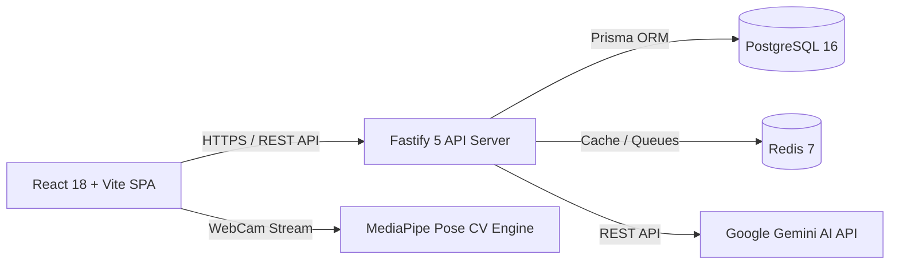

# FitTrack AI - Project Context

## 1. Executive Summary & Mission
FitTrack AI is an enterprise-grade, full-stack personal fitness tracking and intelligent coaching platform. It merges scientific resistance training principles (progressive overload, Epley 1RM trajectory, fatigue management) with modern AI technologies:
1. **Contextual AI Fitness Coach**: Powered by Google Gemini (`@google/genai`), grounded in real biometric and historical training data.
2. **Real-time Computer Vision Form Coach**: Client-side kinematic analysis powered by MediaPipe Pose for instantaneous posture and repetition feedback.
3. **Comprehensive Lifestyle Tracking**: High-precision workout routine builder, live session tracker with rest timer, macronutrient & hydration logging, and 7-day smoothed body composition tracking.

---

## 2. Core User Personas & Use Cases

| Persona | Primary Needs | Key FitTrack Features Utilized |
|---|---|---|
| **Hypertrophy & Strength Athlete** | Progressive overload tracking, 1RM estimations, set volume calculations, deload scheduling | Workouts, Analytics (1RM chart, volume distribution), Overload Advisor |
| **Fitness Beginner** | Real-time exercise form feedback, structured routines, safety guidance | AI Form Coach, Seeded Exercise Library with step-by-step instructions |
| **Body Recomposition Athlete** | Strict macronutrient adherence, body measurement trends, progress photo tracking | Nutrition, Food Search, Weight Trend with 7-day moving average, Measurements |
| **Bilingual Athlete (EN / VI)** | Seamless localized experience without untranslated strings | Bilingual toggle (`en` / `vi`), culturally relevant food database support |

---

## 3. Core Business Logic Invariants

### A. Canonical Measurement Standards
To prevent measurement corruption across heterogeneous client platforms:
- **Length & Circumference**: Stored strictly in **centimeters (cm)** in all database tables.
- **Weight & Load**: Stored strictly in **kilograms (kg)** in all database tables.
- **Display Layer**: Imperial units (`lbs`, `inches`) are strictly derived at the view layer using standard conversion factors (`1 kg = 2.20462 lbs`, `1 inch = 2.54 cm`).

### B. User Tenancy Isolation
All database access is partitioned by authenticated user ID (`User.id`). A user cannot query, mutate, or inspect another user's workout plans, completed sessions, custom exercises, nutritional logs, or biometric trends.

### C. Immutable Nutrition Snapshots
When a food item is logged into a meal (`MealFoodItem`), its caloric and macronutrient values (protein, carbs, fat) are copied into immutable snapshot fields on the log entry. Subsequent edits or deletions of the parent food item will never retroactively distort historical nutritional logs.

### D. Progressive Overload Heuristics
The platform evaluates overload readiness using verified completed sets:
- Exercises with working loads `< 60 kg` receive `+2.5 kg` recommended increments.
- Exercises with working loads `≥ 60 kg` receive `+5.0 kg` recommended increments.
- A recovery score below `72%` triggers an automated Deload Week suggestion recommending a `40%` working volume reduction.

---

## 4. Technology Stack Overview

- **Frontend**: React 18, Vite 5, TypeScript 5, TailwindCSS 3, Lucide React, `react-i18next`, Recharts.
- **Backend**: Node.js 20, Fastify 5, TypeScript 5, Prisma 5 ORM, Argon2, `@fastify/jwt`, Zod 3, Pino Logger.
- **Infrastructure**: PostgreSQL 16 (local Docker or Neon Cloud), Redis 7, Docker Compose.

---

## Changelog

| Version | Date | Changes |
|---|---|---|
| 1.0.0 | 2026-09-16 | Initial baseline of high-level project context and domain invariants |
