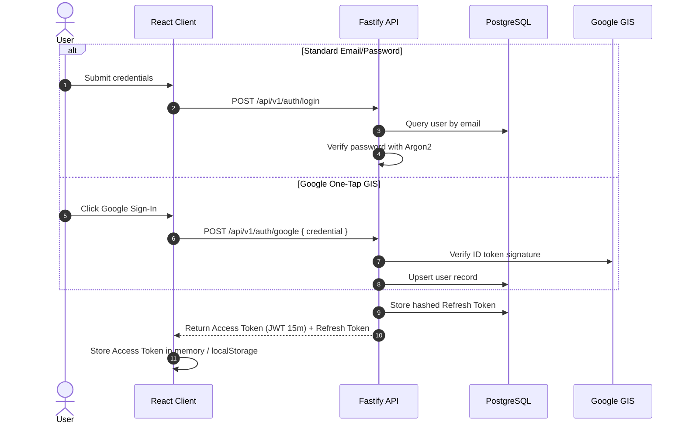

# FitTrack AI - Security & Authentication Architecture

## 1. Threat Model & Security Posture

FitTrack AI stores sensitive user health, body composition, and workout performance metrics. The security model prioritizes:
1. **Zero Tenant Leakage**: Strict user-level tenant boundary isolation across all queries.
2. **Cryptographic Integrity**: Modern hashing algorithms (Argon2) and short-lived JWT credentials.
3. **Hardened API Perimeter**: Strict input validation with Zod, Helmet HTTP headers, and rate limiting.
4. **AI Guardrails**: Defensive prompting and refusal logic around acute medical queries.

---

## 2. Authentication & Credential Architecture

### A. Password Hashing with Argon2
- Algorithm: `Argon2id` (resistant to both side-channel attacks and GPU cracking).
- Implementation: Managed via `argon2` npm package.
- Plaintext passwords are never logged or stored.

### B. Dual-Token JWT Mechanism
- **Access Token**:
  - Expiration: **15 minutes**.
  - Payload: `{ id: string, email: string }`.
  - Verification: Checked on every protected route by `@fastify/jwt`.
- **Refresh Token**:
  - Expiration: **30 days**.
  - Storage: Saved in `refresh_tokens` table.
  - Rotation: Each `/auth/refresh` invocation revokes the existing token and generates a cryptographically random new pair.

---

## 3. API Perimeter Hardening

### A. Strict Schema Validation (Zod)
Every request payload (body, query params, path params) must pass through a strict Zod schema before hitting service logic. Extraneous or malicious fields are stripped or rejected with `400 Bad Request`.

### B. Security Headers (@fastify/helmet)
Configured in `backend/src/app.ts`:
- **Content Security Policy (CSP)**: Blocks unauthorized script execution.
- **Strict-Transport-Security (HSTS)**: Enforces TLS/HTTPS in production.
- **X-Content-Type-Options**: Prevents MIME-sniffing.
- **X-Frame-Options**: Set to `DENY` to defeat clickjacking.

### C. Rate Limiting (@fastify/rate-limit)
- Global Rate Limit: 100 requests per minute per IP address.
- Auth Rate Limit: Aggressive throttling on `/auth/login` and `/auth/register` to neutralize credential-stuffing attacks.

---

## 4. Tenant Isolation & Data Privacy

> [!IMPORTANT]
> **Tenant Isolation Rule**:
> All Prisma read and mutation queries for user resources (workout sessions, nutrition logs, weight logs, measurements) must bind `where: { userId: user.id }`. Under no circumstances may an agent expose an ID-only query (`where: { id: resourceId }`) on user data without checking ownership.

---

## 5. AI Guardrails & Anti-Hallucination Safety

1. **Medical Disclaimer**: If a prompt contains terms such as `pain`, `injury`, `hurt`, `swelling`, or `medical`, the Copilot service automatically halts inference and outputs:
   > *"I cannot provide medical diagnoses or injury rehabilitation advice. If you experience sharp joint pain or discomfort, discontinue immediately and consult a healthcare provider."*
2. **Biometric Grounding**: Prompt engineering strictly limits advice to the user's logged metrics, preventing arbitrary diet advice that conflicts with their declared goals.
3. **Daily Quota Guardrail**: Limits Gemini queries to 15 calls/day per user.

---

## 6. Secrets & Environment Hygiene

- All sensitive keys (`JWT_SECRET`, `GEMINI_API_KEY`, `DATABASE_URL`) are loaded from `.env` via `dotenv` and strictly validated on startup by `config/env.ts`.
- `.env` is explicitly ignored in `.gitignore`.
- Dummy sample variables are provided solely in `.env.example`.

---

## Changelog

| Version | Date | Changes |
|---|---|---|
| 1.0.0 | 2026-09-16 | Initial baseline security specifications, auth architecture, and tenant isolation rules |
